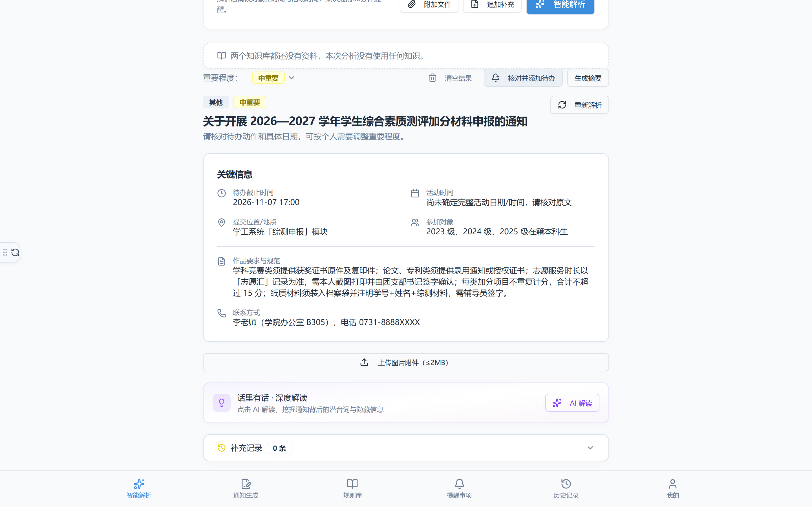
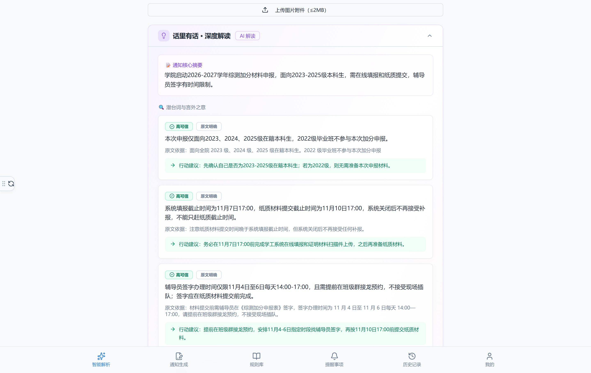
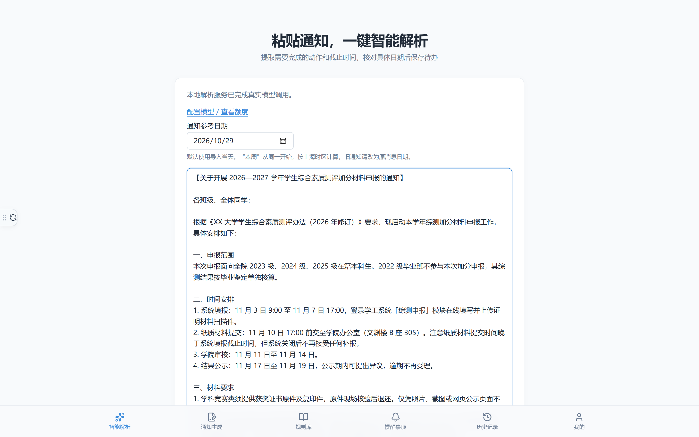
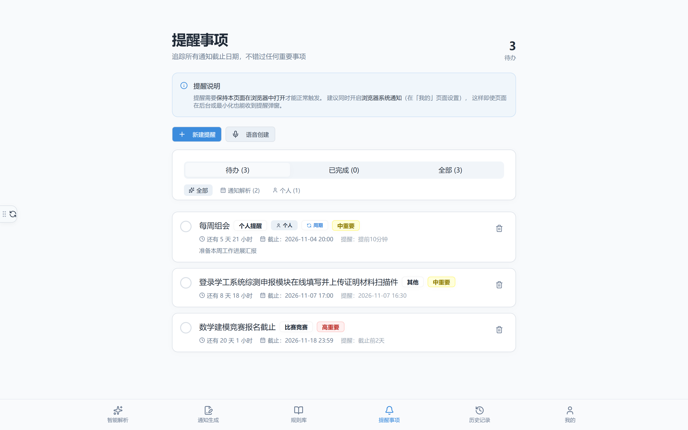

# 通知智析

把群通知、公众号文章、说明文件解析成结构化的待办事项：提取时间、地点、截止要求，生成可提醒的任务。

面向学校、社团、社区这类「通知多、格式乱、容易漏」的场景。全部在本机运行，数据不出本机，模型密钥也只存在本机。



## 它和「丢给 AI 总结一下」的区别

| | 聊天式总结 | 通知智析 |
|---|---|---|
| 输出 | 一段文字，看完还得自己记 | 待办 + 截止时间 + 提醒，直接进清单 |
| 依据 | 说得通就行，可能是编的 | 每条结论都要引用原文，引文对不上原文就判解析失败 |
| 日期 | 常见把「下周三」算错、把年份猜错 | 相对日期由代码按参考日期计算，不交给模型；原文没写清就留空要你补 |
| 责任 | 漏了不知道找谁 | 原文、解析结果、解读依据一起留档，可回溯 |

日期这一条最容易被低估：模型把「11 月 7 日」写成「2025-11-07」而实际是 2026 年，比不解析更危险。所以它宁可留空让你确认，也不替你猜。

## 效果示例

下面这条学院通知，表面上到处都是「截止时间」，实际藏着三个容易踩的坑。原文见 [docs/examples/sample-notice.md](docs/examples/sample-notice.md)，解析与解读的完整原始输出也在同一目录。

<details>
<summary>点开查看通知原文（921 字）</summary>

> 【关于开展 2026—2027 学年学生综合素质测评加分材料申报的通知】
>
> 各班级、全体同学：
>
> 根据《XX 大学学生综合素质测评办法（2026 年修订）》要求，现启动本学年综测加分材料申报工作，具体安排如下：
>
> 一、申报范围
> 本次申报面向全院 2023 级、2024 级、2025 级在籍本科生。2022 级毕业班不参与本次加分申报，其综测结果按毕业鉴定单独核算。
>
> 二、时间安排
> 1. 系统填报：11 月 3 日 9:00 至 11 月 7 日 17:00，登录学工系统「综测申报」模块在线填写并上传证明材料扫描件。
> 2. 纸质材料提交：11 月 10 日 17:00 前交至学院办公室（文渊楼 B 座 305）。注意纸质材料提交时间晚于系统填报截止时间，但系统关闭后不再接受任何补报。
> 3. 学院审核：11 月 11 日至 11 月 14 日。
> 4. 结果公示：11 月 17 日至 11 月 19 日，公示期内可提出异议，逾期不再受理。
>
> 三、材料要求
> 1. 学科竞赛类须提供获奖证书原件及复印件，原件现场核验后退还。仅凭照片、截图或网页公示页面不予认定。
> 2. 论文、专利类须提供录用通知或授权证书，且在 2026 年 9 月 1 日至 2027 年 8 月 31 日期间取得。
> 3. 志愿服务时长以「志愿汇」平台记录为准，需本人截图并打印，由团支部书记签字确认。
> 4. 每类加分项目不重复计分，同一赛事获多个奖项按最高等级计一次。
>
> 四、加分上限
> 本次加分合计不超过 15 分。其中社会实践与志愿服务类单项不超过 4 分，文体活动类单项不超过 3 分。
>
> 五、注意事项
> 1. 纸质材料须由本人整理后装入档案袋，封面注明「学号+姓名+综测材料」。
> 2. 材料提交前需辅导员在《综测加分申报表》签字，签字办理时间为 11 月 4 日至 11 月 6 日每天 14:00—17:00，请提前在班级群接龙预约，不接受现场插队。
> 3. 逾期未提交或材料不全者，视为放弃本次加分，不予补办。
>
> 联系人：李老师（学院办公室 B305），电话 0731-8888XXXX
>
> XX 大学 XX 学院学生工作办公室
> 2026 年 10 月 28 日

</details>

### 解析结果

参考日期设为 2026-10-29，真实调用模型耗时 31.5 秒：

| 字段 | 结果 |
|---|---|
| 标题 | 关于开展 2026—2027 学年学生综合素质测评加分材料申报的通知 |
| 待办动作 | 在学工系统「综测申报」模块在线填写并上传证明材料扫描件 |
| 待办截止 | 2026-11-07 17:00 |
| 提醒时间 | 2026-11-07 16:30（自动提前 30 分钟） |
| 地点 | 学工系统「综测申报」模块；纸质材料交至学院办公室（文渊楼 B 座 305） |
| 对象 | 2023 级、2024 级、2025 级在籍本科生，2022 级毕业班不参与 |
| 联系方式 | 李老师（学院办公室 B305），电话 0731-8888XXXX |
| 警告 | 无 |

### 深度解读：把原文没说透的地方摆出来

模型返回 6 条，每条都带原文引用与行动建议，耗时 41.5 秒。三条最容易被漏掉的：

1. **两个截止时间，真正的死线是早的那个。** 系统填报 11 月 7 日 17:00，纸质材料 11 月 10 日 17:00——看上去纸质更晚就能拖，但原文写明「系统关闭后不再接受任何补报」。拖到 8 号才动手，纸质材料准备得再齐也没用了。
2. **签字窗口比所有截止时间都早。** 辅导员签字只在 11 月 4 日至 6 日每天 14:00—17:00 办理，还要提前在班级群接龙预约、不接受现场插队。这条写在「注意事项」里，很容易被当成客套话跳过。
3. **证书要原件，截图不算。** 「仅凭照片、截图或网页公示页面不予认定」——不少人的证书还在学院或家里，得提前预留时间取回。

完整 6 条见 [docs/examples/interpret-result.json](docs/examples/interpret-result.json)。逐条检查过，6 条引用的原文片段全部在通知里逐字存在。



## 能做什么

| 能力 | 说明 |
|---|---|
| 通知解析 | 粘贴文字或公众号链接，提取标题、类型、截止时间、活动时间、地点、对象、要求、联系人、链接 |
| 多材料合并 | 群通知 + PDF/Word 说明文件 + 公众号文章一起解析，冲突项会明确提示而不是替你取舍 |
| 配图识别 | 公众号文章里的海报、截图，用视觉模型读出图中文字并合并进正文 |
| 深度解读 | 分析容易忽略的前置条件、时间先后、资格限制，每条结论都要求引用原文 |
| 通知生成 | 填表单向，生成格式规范的通知文案 |
| 双知识库 | 个人知识库（只有自己可见）与应用知识库（全员共享），解析时按权限检索并标注引用来源 |
| 提醒 | 一次性或周期提醒，支持稍后提醒、语音、浏览器通知 |

## 界面

粘贴通知就能解析。「通知参考日期」默认今天，「本周三」「下周一」这类相对日期全靠它换算：



解析结果先进入核对弹窗，确认动作和具体日期后才进清单——模型给的时间只是候选，最终由你点头。截止时间与活动开始时间是分开的字段，不会把「活动几点开始」错当成「什么时候截止」。

保存后进入提醒事项，按截止时间排序，显示剩余天数：



## 快速开始

### 方式一：下载即用（Windows，不需要安装 Node）

到 [Releases](https://github.com/fynn7r/notification-analysis1.0/releases) 下载 `notizhi-portable-win-x64.zip`，解压后双击 `start.bat`，浏览器会自动打开。压缩包里已经带好 Node 运行时，整台机器不用装任何东西，换电脑也是复制文件夹即可。

首次启动会在窗口里打印管理员账号和密码，**只显示一次**。同目录的 `HOW-TO-START.txt` 写了启动步骤、数据存放位置和常见问题处理。

### 方式二：从源码运行

需要 Node.js 22.18 或更高版本（含 24；服务端直接导入 .ts 契约文件，依赖 22.18 起默认开启的类型剥离）。

```bash
npm install
npm start
```

打开终端里提示的地址（默认 `http://127.0.0.1:8001`）。

首次启动会自动完成三件事，不需要额外命令：

1. 从 `.env.example` 生成 `.env.local`
2. 构建前端（约 20-40 秒，之后不再重复）
3. 创建管理员账号并在终端打印初始密码 —— **只显示一次，请立即记录**

## 填写模型密钥

页面里打开「我的 → 模型接入」，填三样：

| 项 | 示例 |
|---|---|
| API 基础地址 | `https://api.deepseek.com` |
| API 密钥 | 服务商控制台创建 |
| 默认模型 | `deepseek-flash` |

支持任何 OpenAI 兼容的 Chat Completions 接口。保存后立即生效，不必重启。

> 没有密钥也可以打开页面、浏览已保存的待办，但真实解析会明确提示未配置，不会返回假结果。

### 输出上限与超时

思考型模型（如 DeepSeek V4 系列）的思考过程与正文**共用同一份输出额度**，额度给少了会在正文写一半时被截断。同一条通知的思考长度还会波动，所以贴着边界设很容易时灵时不灵。默认值按实测留足余量：

```ini
AI_MAX_TOKENS=16384
AI_TIMEOUT_MS=120000
```

实测参考：1550 字通知做深度解读约消耗 4700–7900 token、耗时 16–52 秒；3000 字级别约需 27–63 秒。

这两项都可以在「我的 → 模型接入」页面直接改，不必编辑文件。调高上限时超时要一起放宽 —— 输出越长必然越慢，只加上限会从「被截断」变成「超时」。

浏览器这一侧的等待上限是 300 秒，比服务端的 `AI_TIMEOUT_MS` 宽得多，所以超时永远由服务端先触发、给出「模型多久没响应」的明确原因，而不会出现「服务端还在生成、页面已经放弃」的错位。

### 配图识别（可选）

公众号文章里的图默认只留 `[图片 N]` 占位符并提示「未读取图中文字」。要真正读图，在 `.env.local` 里指定一个支持视觉的模型：

```ini
AI_VISION_MODEL=qwen3-vl-plus
```

`deepseek-flash`、`qwen3-vl-plus` 等均可。用同一家的模型时不必再填地址和密钥；跨服务商时可单独指定 `AI_VISION_BASE_URL` / `AI_VISION_API_KEY`。留空即关闭，不影响正文解析。

## 常用命令

| 命令 | 用途 |
|---|---|
| `npm start` | 单端口启动（前端 + API），日常用这个 |
| `npm run dev:standalone` | 开发模式，热更新，前端 8001 + API 3001 |
| `npm run test:api` | 接口与业务逻辑测试 |
| `npm run typecheck` | TypeScript 类型检查 |
| `npm run lint` | 类型检查 + ESLint |
| `npm run build:standalone` | 只构建前端产物到 `dist-standalone/` |
| `npm run build:portable` | 打包 Windows 便携版 zip 到 `dist-portable/`（内含 Node 运行时） |
| `npm run admin:knowledge` | 账号管理（`list` 查看、`invite` 生成邀请码） |
| `npm run test:browser` | Playwright 浏览器端到端测试（跑开发服务器，改代码即时生效） |
| `npm run test:browser:prod` | 同上，但跑构建产物（与 `npm start` 完全一致，上线前用它回归） |

## 数据存在哪

| 内容 | 位置 | 备份建议 |
|---|---|---|
| 账号、知识库、邀请码 | `.local/knowledge/knowledge.db` | 复制整个 `.local/` 目录 |
| 模型密钥与端口配置 | `.env.local` | 含密钥，单独妥善保存 |
| 待办、提醒、历史、个人设置 | 浏览器 localStorage | 换浏览器或清缓存会丢失 |

`.gitignore` 已排除 `.env.local`、`.local/`、`dist-standalone/`，误提交不会泄露密钥和业务数据。

## 已知限制

- **扫描版 PDF 读不出文字**。需要文字层，纯图片 PDF 请先 OCR。
- **合计 20000 字上限**。原文优先占用，参考材料按顺序填充，装不下的会明确提示用了多少字。
- **公众号文章可能被风控拦截**。遇到「环境异常」验证页时会提示手动粘贴正文，不会静默失败。
- **公众号只支持 `mp.weixin.qq.com`**。其他链接（校内系统、腾讯文档）通常需要登录，抓回来是登录页，因此直接拒绝而不盲目抓取。
- **提醒依赖页面处于打开状态**。网页应用在完全关闭时无法响铃，这是浏览器能力边界，不是配置问题。
- **日期证据必须逐字出现在原文中**。模型若引用不到原文片段，会判定解析失败而不是编造时间。

## 技术栈

React 19 + TypeScript + Vite 8 + Tailwind v4 + shadcn/ui + Zod 4；服务端为 Node 原生 `http`，数据库用内置 `node:sqlite`（FTS5 全文索引），无外部数据库依赖。

## 目录结构

```
server/            服务端（API、解析、知识库、静态托管）
  index.mjs        单端口服务入口
  parse-service.mjs  通知解析（含提示词与校验）
  article-extract.mjs 公众号正文提取
  vision-service.mjs  配图文字识别
  knowledge/       账号、权限、检索
shared/            前后端共享的 Zod 契约与日期工具
src/               前端（pages / components / hooks / lib）
scripts/           启动、管理、验证脚本
```

## 开发约定

- 新增页面放在 `src/pages/<PageName>/PageName.tsx`，并在 `src/app.tsx` 的 `<Routes>` 内注册
- `BrowserRouter` 已在入口配置，`app.tsx` 内不要再包一层 Router
- 路径别名：`@/` → `src/`，`@shared/` → `shared/`
- 主题色定义在 `src/index.css`，通过 CSS 变量 + `@theme inline` 接入 Tailwind
- 改动后至少跑一遍 `npm run lint` 与 `npm run test:api`

## 许可证

MIT，见 [LICENSE](LICENSE)。
